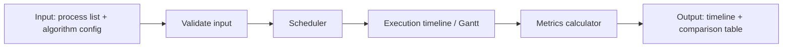

# Thiết kế hệ thống

## Mục tiêu

Mô phỏng cùng một tập tiến trình bằng FCFS, SJF, SRTF, Priority và Round Robin; xuất biểu đồ Gantt và các chỉ số để so sánh tính công bằng, thời gian chờ và thông lượng.

## Luồng xử lý

## Dữ liệu vào

Mỗi tiến trình có `processId`, `arrivalTime`, `burstTime` và `priority`. `arrivalTime` không âm, `burstTime` phải lớn hơn 0. Priority có số nhỏ hơn là độ ưu tiên cao hơn. Round Robin nhận thêm `quantum` nguyên dương.

## Các thành phần

- `model`: `Process`, `ScheduleResult`, `ExecutionSlice` và cấu hình thuật toán.
- `algorithm`: giao diện lập lịch và năm cài đặt thuật toán; chỉ quyết định tiến trình kế tiếp/chạy tiếp.
- `simulation`: mô phỏng thời gian, xử lý tiến trình đến và CPU idle, ghi timeline.
- `metrics`: tính completion, turnaround, waiting, response, throughput và CPU utilization từ timeline.
- `cli`: nhận workload/cấu hình và trình bày kết quả.

Tách bộ mô phỏng khỏi thuật toán giúp dùng chung cách ghi timeline và tính chỉ số; nhờ đó kết quả các thuật toán có thể so sánh trên cùng quy ước.

## Kết quả

Mỗi lần chạy trả về thứ tự các execution slice, thời điểm hoàn thành của từng tiến trình, Gantt chart và bảng chỉ số. Tiến trình đang chạy không tạo slice mới nếu tiếp tục chạy liên tục; các đoạn CPU idle được biểu diễn riêng.
